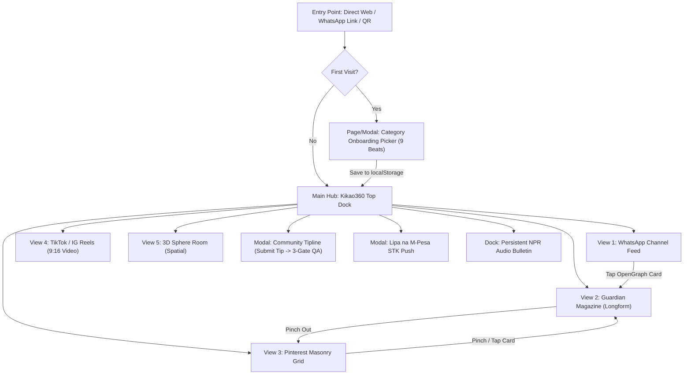

# Kikao360 — User Navigation Flow, Pages Map & MoSCoW Component Samples

This document maps the **pages & user navigation flow** and breaks down the **standalone UI component samples** (organized by MoSCoW priority) before full system assembly.

---

## 1. User Navigation Flow & Pages Map

### Core Pages / Views
1. **Onboarding Category Picker (`/prototype/samples.html#onboarding` & modal in `index.html`)** — First-visit interest selection across 9 beats.
2. **WhatsApp Channel View** — Familiar messaging feed with OpenGraph story cards and reaction pills.
3. **The Magazine (Guardian View)** — Deep-dive investigative reading view with Read/Watch/Listen tabs and pull-quotes.
4. **Pinterest Masonry Grid** — Visual discovery board for infographics, fashion/art cards, and quick reads.
5. **Reels / TikTok Feed** — 9:16 vertical short-form video dispatches (60s).
6. **3D Sphere Room** — Spatial 360° discovery room (`SphericalRoom`).
7. **Component Sandbox (`prototype/samples.html`)** — Isolated preview of every Must / Should / Could Have component for team review & investor pitch screenshots.

---

## 2. Finalized Category List (9 Youth Beats)

| # | Category | Role in Editorial Strategy | Example Kikao360 Story |
| :---: | :--- | :--- | :--- |
| 1 | **Politics & Current Affairs** | Civic awareness & accountability | *County Budgets & Youth Fund Audits* |
| 2 | **Business & Finance** | Practical MSME, eTIMS & hustle intelligence | *M-Pesa Daraja APIs for Gen-Z Merchants* |
| 3 | **Technology** | AI, cybersecurity & Kenyan dev ecosystem | *Cold-Chain IoT Hacking Risks* |
| 4 | **Campus & Youth** | Hyper-local university life & opportunities | *USIU-Africa Venture Sprint* |
| 5 | **Entertainment** | Daily cultural hook & creator economy | *Nairobi Indie Film & Music Monetization* |
| 6 | **Sports** | Youth athletics, esports & local leagues | *Campus Rugby & Sports Sponsorships* |
| 7 | **Art** | Visual storytelling, street art & galleries | *Nairobi Digital Illustrators Collective* |
| 8 | **Fashion** | Kenyan streetwear & sustainable thrifting | *Gikomba to Instagram: Thrift Supply Chains* |
| 9 | **Lifestyle** | Mental health, housing & urban living | *Surviving Nairobi Rent on an Entry Salary* |

---

## 3. MoSCoW Component Samples Breakdown

* **MUST HAVE (Core MVP):**
  1. **Category Onboarding Picker** (9-beat chip selector)
  2. **WhatsApp Channel OpenGraph Card** (verified badge, media preview, reaction pills, deep link)
  3. **IG Reel & TikTok 9:16 Previews** (vertical video with native platform overlays & captions)
  4. **Guardian Magazine Editorial Card** (serif headline, byline, pull-quote, multimodal tabs)
  5. **Community Tipline & 3-Gate Verification Card** (EXIF check → Two-Source Rule → Editor Sign-off)
* **SHOULD HAVE (Engagement & Monetization):**
  6. **Pinterest Masonry Discovery Card**
  7. **Persistent NPR-Style Audio Dock**
  8. **Lipa na M-Pesa STK Push Card**
* **COULD HAVE (Differentiation / Wow Factor):**
  9. **Inside-the-Sphere 3D Spatial Room**
